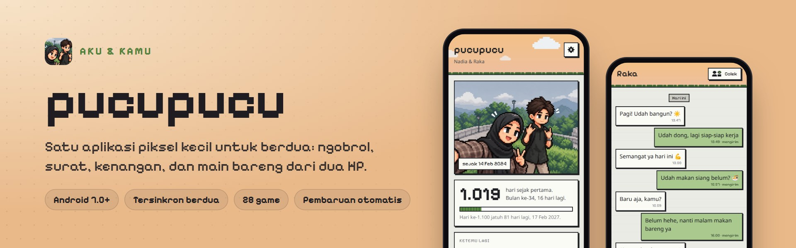
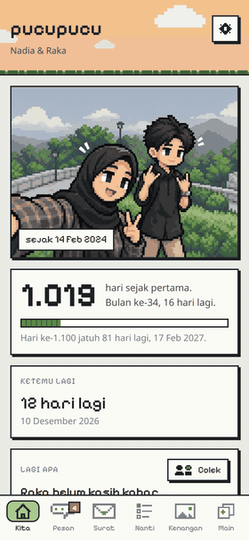
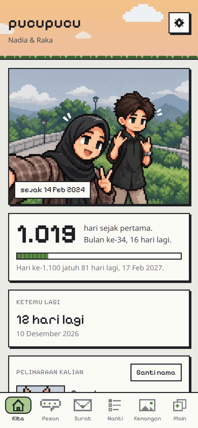
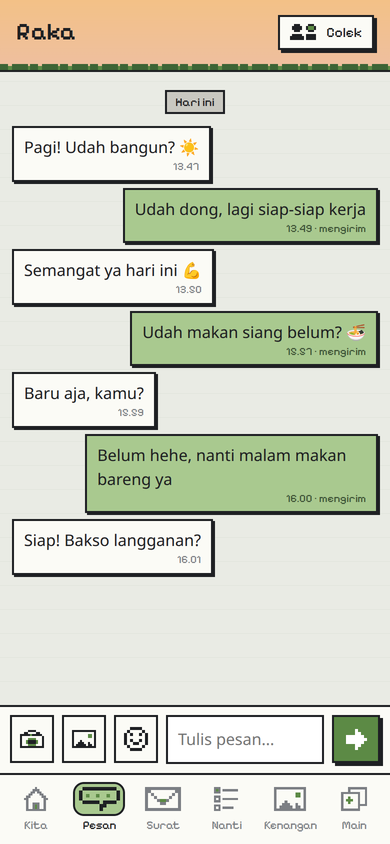
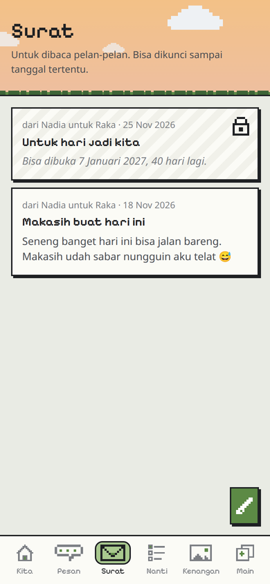
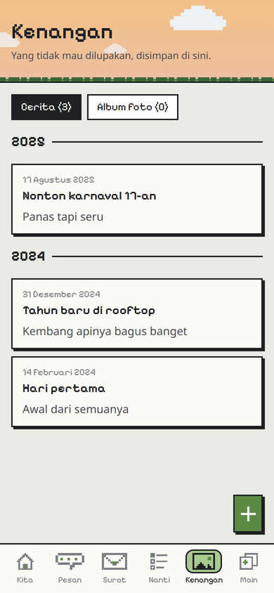
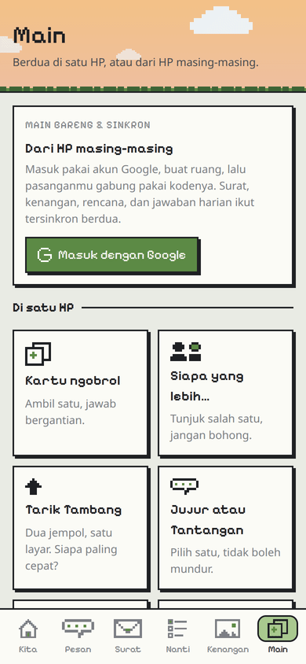
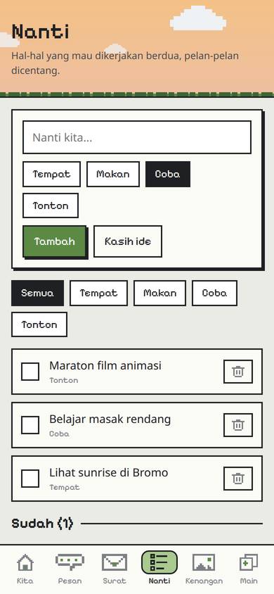

  

  
  

  
  
  
  
  
  

**pucupucu** (*Aku & Kamu*) adalah aplikasi Android kecil bergaya piksel untuk pasangan: menyimpan kenangan, surat, tanggal penting, kabar, dan main bareng, semuanya **tersinkron berdua**. Aplikasinya tetap jalan tanpa internet; begitu kalian satu ruang, isinya ikut ke HP pasangan dan tersimpan di server, jadi masuk lagi dengan Google di HP baru dan semuanya kembali.

Repo ini hanya berisi **file rilis (APK)** dan catatan tiap versi; kode sumbernya privat.

## Sekilas

<table>
  <tr>
    <td align="center"> Pindah tab</td>
    <td align="center"> Kita</td>
    <td align="center"> Pesan</td>
  </tr>
  <tr>
    <td align="center"> Surat</td>
    <td align="center"> Kenangan</td>
    <td align="center"> Main</td>
  </tr>
</table>

 Nanti

Nama dan isi di tangkapan layar hanya contoh.

## Fitur utama

- **Kita**: foto sampul, hitungan hari bersama, pertanyaan harian berdua, "lagi apa" + colekan, dan peliharaan **Pucu** yang dirawat berdua (koin dari game bisa ditukar aksesori di Toko Pucu)
- **Tanggal penting**: ulang tahun, hari jadi, rencana; tersinkron berdua. Ada juga kartu **Hari ini dulu** (kenangan di tanggal yang sama tahun lalu)
- **Jarak kita**: peta piksel dari OpenStreetMap dengan wajah kalian, jarak, kota, dan baterai. Cari lokasi terbaru, bunyikan HP pasangan dari jauh walau senyap, buka rute, atau buat kartu jarak untuk dibagikan. Lokasi hanya dikirim kalau dinyalakan sendiri
- **Pesan**: obrolan berdua dengan emoji lengkap, kirim foto, balas pesan tertentu, reaksi, tanda "sedang mengetik" dan "dibaca", serta balas langsung dari notifikasi
- **Surat**: tulis surat yang bisa dikunci sampai tanggal tertentu
- **Nanti**: daftar rencana berdua (tempat, makan, coba, tonton)
- **Kenangan**: linimasa per tahun dengan cerita dan foto, plus album foto
- **Main bareng**: 8 game di satu HP dan 20 game dari HP masing-masing, dari Jalan Bareng, Payung & Lentera, sampai Ular Tangga Cinta dan Tebak Kata
- **Widget layar utama**: foto kalian, hitungan hari, kabar dan lokasi pasangan, serta pesan terakhirnya
- **Cadangan**: simpan ke satu file JSON di folder Download, pulihkan dari file itu

## Unduh & pasang

**Android** (7.0 atau lebih baru):

1. Ambil APK versi terbaru di halaman **[Releases](https://github.com/ky-Mind/pucupucu-releases/releases/latest)**.
2. Buka berkasnya di HP, ketuk **Pasang** (izinkan "instal dari sumber ini" bila diminta).
3. Buka pucupucu, isi nama kalian dan hari pertama, atau **Masuk dengan Google** kalau sudah pernah memakai pucupucu.
4. Supaya tersinkron berdua: buka tab **Main**, masuk dengan Google, lalu buat ruang dan kirim kodenya ke pasanganmu (atau gabung pakai kode darinya).

**Di browser:** buka <https://pucupucu.web.id>, masuk dengan Google, lalu pakai versi browsernya (isi sama dengan aplikasi Android).

## Cara memperbarui

1. Buka **pucupucu**.
2. Saat ada versi baru, kotak **"Perbarui"** muncul otomatis; ketuk untuk memasang.
3. Tanpa Play Store; pembaruan dicek tiap ~15 menit.

Bisa juga mengunduh APK terbaru dari [Releases](https://github.com/ky-Mind/pucupucu-releases/releases/latest) lalu memasangnya di atas versi lama. Data kalian tetap ada.

## Privasi

Data kalian untuk berdua saja. Kode sumber aplikasi privat; repo ini hanya memuat berkas rilis (APK) dan catatan versi.

---

Dibuat dengan 💚 untuk berdua oleh <a href="https://github.com/ky-Mind">ky-Mind</a> · <a href="https://kymind.web.id">kymind.web.id</a>

